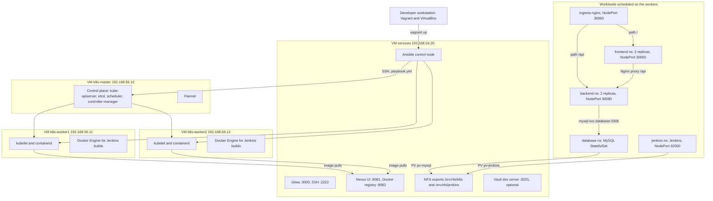
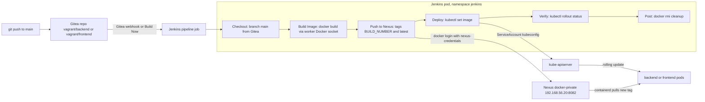
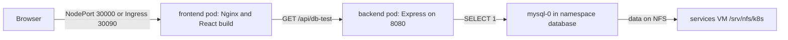

# Kubernetes DevOps Platform: Local Lab

**A reproducible, four-VM Kubernetes platform with a full CI/CD loop (Gitea, Jenkins, Nexus) and a three-tier demo app, provisioned end to end with Vagrant and Ansible.**


> **Scope:** a local lab for learning and demonstrating Kubernetes delivery workflows. It mirrors real-world building blocks (kubeadm, CNI, NFS-backed storage, a private registry, pipeline-driven rollouts, ingress), but uses lab-grade defaults for credentials and security. See [Security notes](#security-notes) and [Limitations](#limitations).

---

## Table of contents

- [Overview](#overview)
- [Key features](#key-features)
- [Architecture](#architecture)
- [Nodes and resources](#nodes-and-resources)
- [Tech stack](#tech-stack)
- [Getting started](#getting-started)
- [Post-provisioning setup](#post-provisioning-setup-cicd)
- [Endpoints](#endpoints)
- [Day-2 operations](#day-2-operations)
- [Configuration](#configuration)
- [Project structure](#project-structure)
- [Troubleshooting](#troubleshooting)
- [Security notes](#security-notes)
- [Limitations](#limitations)
- [Roadmap](#roadmap)
- [Further documentation](#further-documentation)

---

## Overview

Learning Kubernetes delivery end to end usually means juggling a managed cluster, a hosted Git service, a SaaS CI runner and a cloud registry. This project puts the entire chain on your machine instead:

1. **Vagrant** creates four Ubuntu 22.04 VMs on VirtualBox.
2. **Ansible**, installed automatically on the `services` VM, configures the OS, installs containerd and Kubernetes 1.29.2, bootstraps the control plane with `kubeadm`, joins the workers and deploys the Flannel CNI.
3. The **services VM** hosts Gitea (source control), Nexus (Docker registry), an NFS server for persistent volumes, and an optional Vault dev server.
4. The **cluster** runs MySQL (StatefulSet), a Node.js backend, a React frontend, Jenkins, and an ingress-nginx controller.
5. **Jenkins** pulls code from Gitea, builds images, pushes them to Nexus and rolls them out to Kubernetes.

**Who it's for:** DevOps and platform engineers, students, and anyone preparing for Kubernetes work who wants a realistic, inspectable, disposable environment rather than a single-node toy cluster.

## Key features

- **One-command bootstrap:** `vagrant up` creates the VMs and runs the full Ansible playbook. No Ansible is needed on the host.
- **kubeadm cluster:** 1 control-plane node and 2 workers, with pinned Kubernetes packages (`1.29.2-1.1`, held with `dpkg`), containerd with `SystemdCgroup`, and Flannel pinned to the host-only interface (`enp0s8`).
- **Private CI/CD toolchain:** Gitea and Nexus run as Docker containers on a dedicated VM, isolated from the cluster nodes.
- **Jenkins inside Kubernetes:** Jenkins runs as a Deployment with a ServiceAccount and an in-cluster kubeconfig (`tokenFile`, no static tokens). It uses the worker's Docker socket to build images.
- **Persistent storage over NFS:** MySQL and Jenkins data live on NFS-backed PersistentVolumes exported by the services VM (`Retain` policy).
- **Three-tier demo app:** React + Nginx frontend, Express + mysql2 backend with health and DB-check endpoints, and a MySQL 8.0 StatefulSet. Each tier has its own namespace.
- **Ingress:** ingress-nginx (bare-metal manifest `controller-v1.11.3`) on a fixed NodePort, routing `/` to the frontend and `/api` to the backend.
- **Idempotent, tag-driven playbook:** re-run any layer independently (`services`, `apps`, `jenkins`, `ingress`, `vault` and more).
- **Optional Vault dev server** pre-seeded with the platform's lab secrets, as a first step toward centralized secret management.

## Architecture

### Platform topology



### CI/CD pipeline

This matches the declarative pipelines in [`app/backend/Jenkinsfile`](app/backend/Jenkinsfile) and [`app/frontend/Jenkinsfile`](app/frontend/Jenkinsfile).



### Request path



The frontend calls `/api/db-test`. Nginx proxies `/api/` to the backend, which checks MySQL and returns a JSON status that the UI displays.

## Nodes and resources

Defined in [`Vagrantfile`](Vagrantfile) and [`ansible/inventory.ini`](ansible/inventory.ini). All VMs use the `ubuntu/jammy64` box, a host-only network `192.168.56.0/24` plus NAT, and a 600 s boot timeout.

| VM | IP | vCPU | RAM | Inventory group | Role |
|----|----|------|-----|-----------------|------|
| `k8s-master` | 192.168.56.10 | 2 | 4 GB | `masters` | Kubernetes control plane, `kubectl` entry point |
| `k8s-worker1` | 192.168.56.11 | 2 | 3 GB | `workers` | Application workloads, Jenkins, Docker for builds |
| `k8s-worker2` | 192.168.56.12 | 2 | 3 GB | `workers` | Application workloads, Jenkins, Docker for builds |
| `services` | 192.168.56.20 | 2 | 4 GB | `services` | Ansible control node, Gitea, Nexus, NFS server, Vault (optional) |
| **Total** | | **8** | **14 GB** | | |

## Tech stack

| Layer | Component | Version | Defined in |
|-------|-----------|---------|------------|
| Virtualization | Vagrant + VirtualBox | `ubuntu/jammy64` box | `Vagrantfile` |
| OS | Ubuntu | 22.04 LTS | `Vagrantfile` |
| Provisioning | Ansible | latest from pip, installed on `services` at provision time | `Vagrantfile` |
| Kubernetes | kubeadm, kubelet, kubectl | `1.29.2-1.1` (pkgs.k8s.io `v1.29`) | `ansible/group_vars/all.yml` |
| Container runtime | containerd | Ubuntu package | `ansible/roles/containerd` |
| CNI | Flannel | latest release manifest, pod CIDR `10.244.0.0/16` | `ansible/group_vars/all.yml` |
| Ingress | ingress-nginx | `controller-v1.11.3` (bare metal) | `ansible/roles/ingress` |
| CI | Jenkins | `jenkins/jenkins:lts` | `ansible/roles/jenkins/files/deployment.yaml` |
| SCM | Gitea | `gitea/gitea:latest` | `ansible/roles/gitea` |
| Registry | Sonatype Nexus 3 | `sonatype/nexus3:latest` | `ansible/roles/nexus` |
| Secrets (optional) | HashiCorp Vault | `hashicorp/vault:1.17` (dev mode) | `ansible/roles/vault` |
| Build engine | Docker | `docker.io` Ubuntu package | `ansible/roles/docker` |
| Storage | NFS | `nfs-kernel-server` / `nfs-common` | `ansible/roles/nfs_server`, `nfs_client` |
| Database | MySQL | `mysql:8.0` | `ansible/roles/mysql/files/statefulset.yaml` |
| Backend | Node.js, Express, mysql2 | `node:20-alpine`, `^4.18.2`, `^3.6.5` | `app/backend` |
| Frontend | React, Vite, Nginx | `^18.2.0`, `^5.0.8`, `nginx:alpine` | `app/frontend` |

## Getting started

### Prerequisites

| Requirement | Notes |
|-------------|-------|
| **Host RAM** | The VMs need 14 GB, so plan for a 16 GB host at minimum. 24 GB or more is comfortable. |
| **Host CPU** | 8 vCPUs are allocated in total. A 4-core/8-thread CPU or better is recommended. |
| **VirtualBox** | 7.0 or newer |
| **Vagrant** | 2.4 or newer. The Vagrantfile uploads `~/.vagrant.d/insecure_private_keys/vagrant.key.rsa` to the services VM; make sure that file exists. |
| **Internet access** | Packages, container images and manifests are downloaded during provisioning. |

You don't need Ansible on the host: the Vagrantfile installs it on the `services` VM and runs the playbook from there. The setup works the same on Linux, macOS and Windows hosts.

### 1. Clone and provision

```bash
git clone https://github.com/yessineabdelmaksoud/k8s-project.git
cd k8s-project
vagrant up
```

`vagrant up` creates `k8s-master`, `k8s-worker1`, `k8s-worker2` and then `services`. On the services VM it then:

1. uploads `ansible/` and the Vagrant insecure key,
2. installs Ansible with pip,
3. runs `ansible-playbook -i inventory.ini playbook.yml --become`, which executes every play in order:

| # | Play | Hosts | Roles | Tags |
|---|------|-------|-------|------|
| 1 | Prepare Kubernetes nodes | `k8s_cluster` | `common`, `nfs_client`, `containerd`, `kubernetes` | `base`, `k8s` |
| 2 | Initialize control plane | `masters` | `master` (kubeadm init), `cni` (Flannel) | `base`, `k8s`, `master` |
| 3 | Join workers | `workers` | `workers` | `base`, `k8s`, `workers` |
| 4 | Prepare services node | `services` | `common`, `nfs_server`, `docker`, `gitea`, `nexus` | `services` |
| 5 | Docker on workers | `workers` | `docker` (plus containerd registry mirror) | `docker-workers` |
| 6 | Deploy applications | `masters` | `mysql`, `backend`, `frontend`, `jenkins` | `apps` |
| 7 | Ingress | `masters` | `ingress` | `ingress` |
| 8 | Vault dev server | `services` | `vault` | `vault` |
| 9 | Validate cluster | `masters` | waits for all nodes `Ready`, prints nodes and pods | `validate`, `always` |

### 2. Verify the platform

```bash
# Cluster: 3 nodes Ready, system pods Running
vagrant ssh k8s-master -c "kubectl get nodes -o wide"
vagrant ssh k8s-master -c "kubectl get pods -A"

# Application namespaces and storage
vagrant ssh k8s-master -c "kubectl get ns"
vagrant ssh k8s-master -c "kubectl get pv,pvc -A"
vagrant ssh k8s-master -c "kubectl get statefulset,pods -n database"

# Jenkins pod can reach the API and the Docker daemon
vagrant ssh k8s-master -c "kubectl exec -n jenkins deployment/jenkins -- kubectl get nodes"
vagrant ssh k8s-master -c "kubectl exec -n jenkins deployment/jenkins -- docker info --format '{{.ServerVersion}}'"

# Services VM containers and HTTP status codes
vagrant ssh services -c "sudo docker ps"
vagrant ssh services -c "curl -s -o /dev/null -w '%{http_code}' http://localhost:3000"
vagrant ssh services -c "curl -s -o /dev/null -w '%{http_code}' http://localhost:8081"
```

> The `backend` and `frontend` pods stay in `ImagePullBackOff` until the first pipeline run pushes their images to Nexus. This is expected on a fresh install.

## Post-provisioning setup (CI/CD)

Some steps involve first-run wizards and credentials, so they aren't automated. You do them once.

### 3. Configure Nexus

This step sets the admin password, creates the `docker-private` hosted repository on port `8082`, and enables the Docker Bearer Token realm:

```bash
vagrant upload scripts/nexus-setup.sh /home/vagrant/nexus-setup.sh services
vagrant ssh services -c "bash /home/vagrant/nexus-setup.sh"
```

The script sets the admin password to the value of `NEW_PASSWORD` in [`scripts/nexus-setup.sh`](scripts/nexus-setup.sh). Change it there before running if you don't want the lab default.

### 4. Push the application code to Gitea

1. Open http://192.168.56.20:3000, complete the Gitea install wizard and register a user named **`vagrant`**. The Jenkinsfiles clone from `/vagrant/backend.git` and `/vagrant/frontend.git`.
2. Create two empty repositories: `backend` and `frontend`.
3. Upload the code and push it (Git asks for your Gitea credentials):

```bash
vagrant upload app /home/vagrant/app services
vagrant ssh services
# inside the services VM
git config --global user.name "vagrant"
git config --global user.email "vagrant@local"
for svc in backend frontend; do
  cd /home/vagrant/app/$svc
  git init -b main
  git add . && git commit -m "Initial commit"
  git remote add origin http://localhost:3000/vagrant/$svc.git
  git push -u origin main
done
```

### 5. Configure Jenkins

1. Get the initial admin password:

   ```bash
   vagrant ssh k8s-master -c "kubectl exec -n jenkins deployment/jenkins -- cat /var/jenkins_home/secrets/initialAdminPassword"
   ```

2. Open http://192.168.56.11:32000, unlock Jenkins, install the suggested plugins and create an admin user.
3. Add a credential under **Manage Jenkins > Credentials > (global)**:
   - Kind: *Username with password*
   - ID: **`nexus-credentials`** (the Jenkinsfiles reference this exact ID)
   - Username/Password: your Nexus admin account
4. Create two **Pipeline** jobs (for example `backend-pipeline` and `frontend-pipeline`):
   - Definition: *Pipeline script from SCM*, SCM: *Git*
   - Repository URL: `http://192.168.56.20:3000/vagrant/backend.git` (or `frontend.git`)
   - Branch: `*/main`, Script Path: `Jenkinsfile`
5. Click **Build Now**. The stages Checkout, Build Image, Push to Nexus, Deploy and Verify should all turn green.

### 6. (Optional) Trigger builds from Gitea webhooks

The Jenkinsfiles only define the build steps. Triggers are configured in Jenkins and Gitea:

1. Install the **Gitea** plugin in Jenkins (Manage Jenkins > Plugins) and enable its webhook trigger on each job.
2. In Gitea, open the repository, then go to **Settings > Webhooks > Add Webhook > Gitea**.
3. Target URL: `http://192.168.56.11:32000/gitea-webhook/post`, content type `application/json`.
4. Click **Test Delivery** and confirm that Jenkins responds successfully.

To test end to end, push a change or an empty commit:

```bash
vagrant ssh services -c "cd /home/vagrant/app/backend && git commit --allow-empty -m 'trigger test' && git push origin main"
```

Then check the webhook delivery history in Gitea and confirm that a new Jenkins build started on its own.

### 7. Check the application

```bash
curl http://192.168.56.11:30080/api/health      # {"status":"UP","service":"backend"}
curl http://192.168.56.11:30000/api/db-test     # through the frontend Nginx proxy to MySQL
```

Then open http://192.168.56.11:30000 in a browser.

## Endpoints

NodePorts are reachable on any cluster node IP. The examples below use `k8s-worker1`.

| Service | URL | Notes |
|---------|-----|-------|
| Frontend | http://192.168.56.11:30000 | NodePort, available after the first frontend pipeline run |
| Backend API | http://192.168.56.11:30080/api/health | Also `/api` and `/api/db-test` |
| Ingress | http://k8s-app.local:30090 | Add `192.168.56.11 k8s-app.local` to your hosts file. `/api` goes to the backend. |
| Jenkins | http://192.168.56.11:32000 | Agent port: NodePort `32500` |
| Gitea | http://192.168.56.20:3000 | Git over SSH on port `2222` |
| Nexus UI | http://192.168.56.20:8081 | |
| Docker registry | `192.168.56.20:8082` | Insecure (HTTP) registry, trusted by Docker and containerd on the workers |
| Vault (optional) | http://192.168.56.20:8201 | Dev mode, in-memory storage |

Test the ingress without editing your hosts file:

```bash
vagrant ssh services -c "curl -H 'Host: k8s-app.local' http://192.168.56.11:30090/api/health"
```

## Day-2 operations

```bash
vagrant status                     # VM states
vagrant halt                       # stop all VMs, keep state
vagrant up                         # start again (kubelet needs 1 to 2 minutes to report Ready)
vagrant provision services         # re-run the full Ansible playbook
vagrant destroy -f                 # delete all VMs
```

Run individual layers by tag from the services VM:

```bash
vagrant ssh services -c "cd /home/vagrant/ansible && ANSIBLE_HOST_KEY_CHECKING=false ansible-playbook -i inventory.ini playbook.yml --tags apps --become -v"
```

| Tag | Scope |
|-----|-------|
| `base` / `k8s` | Node preparation, control plane, worker join |
| `master`, `workers` | Control plane only / worker join only |
| `services` | Docker, Gitea, Nexus, NFS server on the services VM |
| `docker-workers` | Docker and the containerd registry mirror on the workers |
| `apps` | MySQL, backend, frontend, Jenkins |
| `ingress` | ingress-nginx and the app Ingress |
| `vault` | Vault dev server and seeded secrets |
| `validate` | Cluster health check (always runs) |

If you edit roles locally, push the changed files to the services VM first, for example `vagrant upload ansible/roles/jenkins/tasks/main.yml /home/vagrant/ansible/roles/jenkins/tasks/main.yml services`. See [`run.md`](run.md) for the full step-by-step sequence.

## Configuration

Main variables in [`ansible/group_vars/all.yml`](ansible/group_vars/all.yml):

| Variable | Default | Purpose |
|----------|---------|---------|
| `kube_version` | `1.29.2-1.1` | Pinned kubelet/kubeadm/kubectl package version |
| `kube_major_version` | `1.29` | Selects the pkgs.k8s.io apt repository |
| `kube_apt_key_url`, `kube_apt_repo` | pkgs.k8s.io `v{{ kube_major_version }}` | Kubernetes apt source |
| `pod_network_cidr` | `10.244.0.0/16` | Pod CIDR passed to `kubeadm init` (Flannel default) |
| `master_ip` | `192.168.56.10` | API server advertise address |
| `flannel_manifest_url` | Flannel `releases/latest/download/kube-flannel.yml` | CNI manifest |
| `cluster_hosts` | the 4 VMs | `/etc/hosts` entries on every node |
| `common_packages` | `apt-transport-https`, `curl`, `gnupg`, ... | Base packages |
| `namespaces` | `database`, `backend`, `frontend`, `jenkins` | Namespace names |
| `nexus_registry` | `192.168.56.20:8082` | Private Docker registry |
| `services_ip` | `192.168.56.20` | Services VM address |

Other tunables:

- **VM sizing and IPs:** the `NODES` array in [`Vagrantfile`](Vagrantfile). If you change IPs, keep `inventory.ini`, `group_vars/all.yml` and the manifests in sync.
- **Pipelines:** the `environment` blocks of the Jenkinsfiles (`NEXUS_URL`, `GITEA_URL`, `IMAGE_NAME`, `NAMESPACE`, `KUBECONFIG`).
- **Database credentials:** the `secret.yaml` manifests in `ansible/roles/mysql/files/` and `ansible/roles/backend/files/`. Change the defaults before exposing the lab to any shared network.

## Project structure

```
k8s-project/
├── Vagrantfile                  # 4 VMs; provisions Ansible from the services VM
├── run.md                       # step-by-step execution guide (staged, tag by tag)
├── ansible/
│   ├── inventory.ini            # masters, workers, services, k8s_cluster
│   ├── group_vars/all.yml       # versions, networking, registry
│   ├── playbook.yml             # 9 ordered, tagged plays
│   └── roles/
│       ├── common/              # swap off, kernel modules, sysctl, /etc/hosts
│       ├── containerd/          # runtime + SystemdCgroup
│       ├── kubernetes/          # kubeadm, kubelet, kubectl (pinned, held)
│       ├── master/              # kubeadm init, kubeconfig, join command
│       ├── cni/                 # Flannel (iface enp0s8)
│       ├── workers/             # kubeadm join
│       ├── nfs_server/          # /srv/nfs/k8s, /srv/nfs/jenkins exports
│       ├── nfs_client/          # nfs-common on cluster nodes
│       ├── docker/              # Docker + insecure registry config
│       ├── gitea/               # Gitea container
│       ├── nexus/               # Nexus container
│       ├── mysql/               # namespace, PV/PVC, secret, StatefulSet, headless svc
│       ├── backend/             # namespace, secret, Deployment, NodePort svc
│       ├── frontend/            # namespace, Deployment, NodePort svc
│       ├── jenkins/             # namespace, SA + RBAC, PV/PVC, Deployment, svc
│       ├── ingress/             # ingress-nginx + app Ingress
│       └── vault/               # Vault dev container + seeded secrets
├── app/
│   ├── backend/                 # Express API, Dockerfile, Jenkinsfile
│   └── frontend/                # React + Vite, Nginx config, Dockerfile, Jenkinsfile
├── scripts/
│   ├── nexus-setup.sh           # Nexus password, docker-private repo, token realm
│   └── jenkins-kubectl-setup.sh # verify Jenkins kubectl, docker and registry access
├── infra/                       # scaffold for a separate infra repo with Ansible Vault
└── docs/                        # architecture, demo script, stage write-ups, fix scripts
```

## Troubleshooting

| Symptom | What to check |
|---------|---------------|
| Provisioning fails or stops | Re-run with more output: `ANSIBLE_VERBOSITY=3 vagrant provision services`. |
| `vagrant up` times out while booting | The VMs are often fine. Check `vagrant status`, then `vagrant reload <vm>` if needed. |
| `VERR_ALREADY_EXISTS` for a VM | A stale VirtualBox registration. Unregister and delete the VM in VirtualBox (`VBoxManage unregistervm <name> --delete`), then retry. |
| Node `NotReady` | `vagrant ssh k8s-master -c "sudo journalctl -u kubelet -f"` and `kubectl describe node <name>`. After `vagrant up`, wait 1 to 2 minutes. |
| Worker join broken | `vagrant ssh k8s-worker1 -c "sudo kubeadm reset -f"`, then `vagrant provision services`. |
| Pods can't reach each other across nodes | `kubectl logs -n kube-flannel -l app=flannel \| grep "Using interface"` must show `enp0s8`, not `enp0s3`. |
| PV stays `Pending` or the mount fails | Check that NFS is exported on the services VM (`showmount -e 192.168.56.20` from the master) and that `nfs-common` is installed on the nodes. |
| MySQL in `CrashLoopBackOff` after failed starts | Leftover InnoDB files on the NFS share (see [`docs/STAGE2_DOCUMENTATION.md`](docs/STAGE2_DOCUMENTATION.md)). **This wipes the database:** run `sudo rm -rf /srv/nfs/k8s/*` on the services VM, then `kubectl delete pod mysql-0 -n database`. |
| Backend/frontend `ImagePullBackOff` | Run the pipeline at least once. If the registry rejects anonymous pulls, [`docs/fix_pull_secrets.sh`](docs/fix_pull_secrets.sh) creates `imagePullSecrets` and patches both Deployments (run it on the master). |
| Jenkins `kubectl` fails in a pipeline | Re-create the in-pod kubeconfig with `--tags jenkins`, or run [`docs/fix_jenkins_config.sh`](docs/fix_jenkins_config.sh) on the master. Then verify with [`scripts/jenkins-kubectl-setup.sh`](scripts/jenkins-kubectl-setup.sh). |
| Pipeline fails at Push to Nexus | Make sure `nexus-setup.sh` has run and the Jenkins credential ID is exactly `nexus-credentials`. |

## Security notes

This is a lab. Several shortcuts are intentional and **must not be reused as-is outside a local environment**:

- Default credentials are committed in plain text: MySQL secrets in the `secret.yaml` manifests, the Nexus password in `scripts/nexus-setup.sh`, and the Vault dev root token in `ansible/roles/vault/tasks/main.yml`. Rotate them, or move them to Ansible Vault (see [`infra/README.md`](infra/README.md)).
- Jenkins runs as root, mounts the node's Docker socket and binds to `cluster-admin`, which gives it full control of the worker and the cluster.
- The Nexus registry and Vault are served over plain HTTP. Vault runs in dev mode with in-memory storage.
- NFS exports use `no_root_squash` for the whole `192.168.56.0/24` subnet.

## Limitations

- Single control-plane node (no HA etcd or API server).
- Image tags and Flannel, Gitea, Nexus and Jenkins versions partly float (`latest`/`lts`), so a rebuild months later can behave differently.
- The frontend's Nginx config proxies `/api/` to a fixed NodePort on `k8s-worker1` (`192.168.56.11:30080`) instead of the in-cluster service name.
- Gitea, Nexus and Jenkins first-run setup (users, repositories, credentials, jobs) is manual.
- Jenkins builds use Docker on the worker node instead of rootless, in-cluster builders.
- No monitoring or logging stack is deployed.

## Roadmap

Ideas for future iterations (not implemented yet):

- Pull credentials from Vault (Kubernetes auth or AppRole) instead of committed secrets.
- Configure Jenkins as code (JCasC) and seed the jobs automatically.
- Replace the Docker socket mount with Kaniko or BuildKit agents.
- Add Prometheus and Grafana for cluster and app observability.
- Package the app manifests as a Helm chart, or deliver them with GitOps (Argo CD).
- Pin every image and manifest version.

## Further documentation

- [Architecture overview](docs/ARCHITECTURE.md)
- [Demo walkthrough](docs/README_DEMO.md)
- [Step-by-step execution guide](run.md)
- [Ansible guide](ansible/README.md) and the per-role READMEs under `ansible/roles/*/README.md`
- [Backend service](app/backend/README.md) · [Frontend service](app/frontend/README.md)
- [Stage 2: storage and MySQL](docs/STAGE2_DOCUMENTATION.md)
- In-depth write-ups (French): [full documentation](docs/DOCUMENTATION.md), [Stage 1 implementation](docs/IMPLEMENTATION_TECHNIQUE_STAGE1.md), [Stage 3 implementation](docs/IMPLEMENTATION_TECHNIQUE_STAGE3.md)

---

Built by [Yessine Abdelmaksoud](https://github.com/yessineabdelmaksoud) · [Portfolio](https://yessineabdelmaksoud.github.io)
