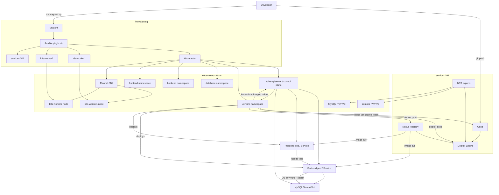

# Architecture Overview

## Goal
This project provisions a local Kubernetes-based delivery platform with Vagrant, Ansible, Jenkins, Gitea, Nexus, MySQL, a Node.js backend, and a React frontend.

## High-Level Flow
1. `vagrant up` creates four virtual machines: `k8s-master`, `k8s-worker1`, `k8s-worker2`, and `services`.
2. Ansible configures the cluster nodes, installs Kubernetes components, sets up containerd, and deploys Flannel.
3. The `services` VM hosts Docker, Gitea, and Nexus.
4. Kubernetes workloads are deployed on the cluster: MySQL, backend, frontend, and Jenkins.
5. Jenkins pulls source code from Gitea, builds images, pushes them to Nexus, and updates Kubernetes deployments.

## Mermaid Diagram

## Data Flow
- Developer code lives in `app/backend` and `app/frontend`.
- Git repositories are hosted in Gitea on the `services` VM.
- Jenkins jobs clone code from Gitea using `Jenkinsfile` pipelines.
- Jenkins builds Docker images locally on its pod using the host Docker socket and `docker` binary mounts.
- Images are pushed to Nexus Docker Registry.
- Kubernetes deployments reference those images and roll out updates in the `backend` and `frontend` namespaces.
- The backend reads MySQL connection settings from environment variables and the MySQL secret.
- The frontend calls `/api/db-test`, which is proxied by Nginx to the backend.

## Main Components
- Vagrant: VM lifecycle and provisioning entry point.
- Ansible: idempotent configuration and deployment engine.
- Kubernetes: runtime for application services and Jenkins.
- Gitea: source control host.
- Nexus: Docker registry.
- Jenkins: CI/CD orchestrator.
- MySQL: persistent database service.
- Backend: Node.js API with MySQL connectivity.
- Frontend: React UI that checks backend/database health.

## Where To Read More
- [Backend](../app/backend/README.md)
- [Frontend](../app/frontend/README.md)
- [Jenkins](../ansible/roles/jenkins/README.md)
- [MySQL](../ansible/roles/mysql/README.md)
- [Gitea](../ansible/roles/gitea/README.md)
- [Nexus](../ansible/roles/nexus/README.md)
- [Kubernetes Base](../ansible/roles/kubernetes/README.md)
- [Containerd](../ansible/roles/containerd/README.md)
- [CNI / Flannel](../ansible/roles/cni/README.md)
- [NFS Server](../ansible/roles/nfs_server/README.md)
- [NFS Client](../ansible/roles/nfs_client/README.md)
